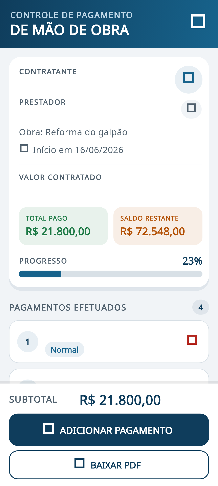
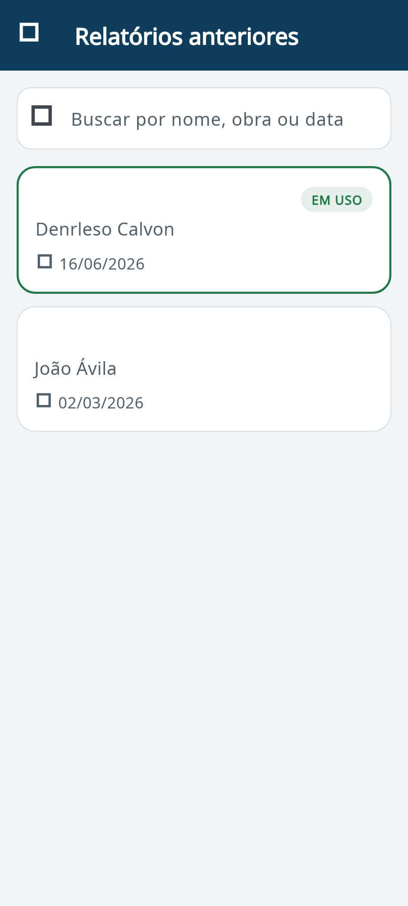

# Controle de Obra

**Controle de Pagamento de Mão de Obra** — aplicativo Android (`.apk`) para controlar
pagamentos de mão de obra, substituindo o caderno de papel. Funciona **offline**, guarda
todos os relatórios no próprio celular e gera um **PDF com o layout de contrato impresso**,
com coluna de assinatura em branco.

## Baixar o aplicativo

➡️ **[Baixar o APK — Controle de Obra 1.0.0](https://github.com/Marcosvx96/controle-de-obra/releases/download/v1.0.0/Controle-de-Obra-v1.0.0.apk)**

Também disponível na página de releases:
<https://github.com/Marcosvx96/controle-de-obra/releases/latest>

Requisito: **Android 7.0 ou superior**. Instale por cima de versões anteriores — os
relatórios são mantidos.

## O que o app faz

- **Tela principal:** título, contratante (com lápis para editar), prestador (com lápis),
  valor contratado, total pago, saldo restante e barra de progresso.
- **Pagamentos:** data, tipo (Normal / Antecipado / Extra) e valor, com subtotal sempre
  visível e cálculo automático.
- **Menu (≡):** criar novo relatório, relatórios anteriores, exportar backup, restaurar backup.
- **Relatórios anteriores:** busca por nome, obra ou data; o último criado fica no topo.
  Ao tocar em um relatório aparecem **ABRIR**, **APAGAR** e **VOLTAR**.
- **PDF:** cabeçalho com contratante, prestador, data de início, valor contratado, total
  pago e saldo; tabela com Nº, Data, Tipo, Valor Pago, Restante acumulado e Assinatura;
  subtotal, assinaturas e número de página. Pode salvar, imprimir ou compartilhar.
- **Extras:** apagar pagamento com DESFAZER, aviso quando o pagamento passa do saldo,
  backup em arquivo `.json` e textos grandes com alto contraste.

## Telas do aplicativo

<p align="center">
  
  
</p>

## Como instalar

1. Baixe o APK no link acima (ou na aba **Releases**).
2. No celular, abra o arquivo e permita "instalar de fontes desconhecidas" quando o
   Android pedir.
3. Pronto: o app abre sem precisar de internet.

## Como usar

1. Toque em **CRIAR MEU PRIMEIRO RELATÓRIO** e informe data, contratante, prestador e valor.
2. No dia a dia, use **ADICIONAR PAGAMENTO** para lançar cada valor recebido.
3. Toque no lápis para corrigir qualquer dado do contrato.
4. Use **BAIXAR PDF** para salvar, imprimir ou enviar o documento por WhatsApp.
5. No menu **≡**, use **Exportar backup** de vez em quando. O backup é a única forma de
   recuperar os dados se o celular for perdido ou trocado.

## Como o projeto está organizado

```
lib/
  core/        formatação de dinheiro e datas, máscara de moeda, busca sem acento
  data/        modelos, banco SQLite e repositório
  pdf/         geração do PDF e ações de salvar/compartilhar
  services/    backup (exportar/restaurar)
  ui/          telas, diálogos, tema e componentes
test/          testes de formatação, geração do PDF, banco e telas
```

- Banco local: **SQLite** (`sqflite`), arquivo `controle_mao_de_obra.db`.
- Valores são guardados em **centavos** (inteiro), sem erro de arredondamento.
- Um único relatório fica marcado como **ativo**; o anterior continua salvo na lista.
- Escrito em **Flutter** (Material 3), com fontes Noto Sans embutidas no PDF.

## Como compilar

O APK é gerado localmente e publicado em **Releases**.

```bash
flutter pub get
dart run flutter_launcher_icons
flutter test
flutter build apk --release --target-platform android-arm,android-arm64
```

O APK fica em `build/app/outputs/flutter-apk/app-release.apk` (uma cópia é guardada em
`dist/`).

### Assinatura

O app usa uma chave de assinatura fixa (`android/app/upload-keystore.jks`, configurada em
`android/key.properties`, ambos fora do Git). Isso permite instalar uma versão nova
**por cima** da anterior, sem perder os dados. Se a chave for trocada, será preciso
desinstalar o app antes.

## Privacidade

- Nenhum dado sai do celular. Não há login, servidor ou anúncio.
- O backup só é enviado se você escolher para onde (WhatsApp, Drive, e-mail...).
- O repositório contém apenas código: a chave de assinatura do app fica fora do Git.

## Licença

Distribuído sob a licença **MIT** — veja o arquivo [LICENSE](LICENSE).
